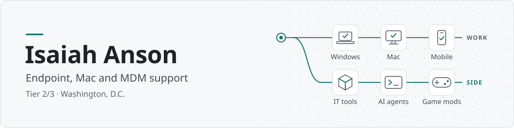

<picture>
  <source media="(prefers-color-scheme: dark)" srcset="assets/banner-v5-dark.svg">
  <source media="(prefers-color-scheme: light)" srcset="assets/banner-v5-light.svg">
  
</picture>

  <a href="https://isaiahanson.pages.dev">Website</a> ·
  <a href="https://isaiahanson.pages.dev/resume">Resume</a> ·
  <a href="https://isaiahanson.pages.dev/experience">Experience</a> ·
  <a href="https://www.linkedin.com/in/isaiah-anson-b6544514b/">LinkedIn</a> ·
  <a href="https://isaiahanson.pages.dev/contact">Contact</a>

I'm an IT support specialist in the Washington, D.C. area. Since 2022 I've supported federal users: first on the Department of Energy service desk, then on Treasury contracts doing deskside, Mac and mobile device support.

Outside work I build things: the tools I wished I had on the job, tools for working with AI coding agents, and game mods. I'm open to Tier 2 desktop support and endpoint roles.

## Endpoint support

What I work with day to day:

| Area | Tools and tasks |
|---|---|
| **Apple and mobile** | macOS, iPhone and iPad in Intune, Apple Business Manager, zero-touch enrollment |
| **Windows** | Windows 10/11, SCCM, Group Policy, BitLocker, VDI and thin clients |
| **Identity and Microsoft 365** | Entra ID, Active Directory, MFA, smart-card sign-in, Microsoft 365 accounts and licenses |

I also write the SOPs that let the next tech close the same ticket. Two field guides from the work:

- [iPhone zero-touch enrollment](https://isaiahanson.pages.dev/guides/iphone-zero-touch-enrollment) with Apple Business Manager and Intune
- [Mac setup before the user arrives](https://isaiahanson.pages.dev/guides/mac-setup-before-the-user-arrives)

## IT tools

| Project | What it does | Built with |
|---|---|---|
| **[asset‑management](https://github.com/IsaiahAnson/asset-management)** | Tracks who holds each piece of equipment, with approvals, custody history and an audit log. Tested in CI against a real database. Demo data only. | Next.js PostgreSQL |
| **[database‑buddy](https://github.com/IsaiahAnson/database-buddy)** | A scheduled workflow that sorts IT documentation from OneDrive into Notion knowledge bases. | Pipedream Notion |

## AI and developer tools

| Project | What it does | Built with |
|---|---|---|
| **[agentic‑hq](https://github.com/IsaiahAnson/agentic-hq)** | A local dashboard for running AI coding agents: skills, routines, usage and a map of the workspace. | Node.js |
| **[behavioral-reconstruction-kit](https://github.com/IsaiahAnson/behavioral-reconstruction-kit)** | Runs the same steps in an original app and your rebuild of it, in a real browser, and shows where the results differ. | Playwright fast‑check |
| **[second‑nature](https://github.com/IsaiahAnson/second-nature)** | A study app with spaced recall, in one HTML file by design. | HTML JavaScript |

## Game mods

I make game mods as **Mentalize**. Releases are on Thunderstore ([Grain Rot](https://thunderstore.io/c/grain-rot/p/Mentalize/), [R.E.P.O.](https://thunderstore.io/c/repo/p/Mentalize/)) and the source is here.

| Game | Mod | What it adds |
|---|---|---|
| **Grain Rot** UE4SS, Lua | [rot-vitals](https://github.com/IsaiahAnson/rot-vitals) | Floating enemy health bars |
| | [rot-radar-minimap](https://github.com/IsaiahAnson/rot-radar-minimap) | A live minimap |
| | [coin-beams](https://github.com/IsaiahAnson/coin-beams) | Loot beams over coins and artifacts |
| | [rot-scaling](https://github.com/IsaiahAnson/rot-scaling) | Enemies that get tougher as the dungeon level rises |
| | [rot-durability](https://github.com/IsaiahAnson/rot-durability) | Durability shown as uses remaining |
| | [grip-and-flip](https://github.com/IsaiahAnson/grip-and-flip) | Three-axis rotation for held objects |
| **R.E.P.O.** BepInEx, C# | [REPOPathfinder](https://github.com/IsaiahAnson/REPOPathfinder) | A dot trail to the extraction point |
| | [REPOBlacklist](https://github.com/IsaiahAnson/REPOBlacklist) | A host-side filter for shop items, valuables and enemies |
