<picture>
  <source media="(prefers-color-scheme: dark)" srcset="assets/banner-v6-dark.svg">
  <source media="(prefers-color-scheme: light)" srcset="assets/banner-v6-light.svg">
  
</picture>

  
  <a href="https://isaiahanson.pages.dev"><picture><source media="(prefers-color-scheme: dark)" srcset="assets/btn-website-dark.svg"></picture></a>
  <a href="https://isaiahanson.pages.dev/experience"><picture><source media="(prefers-color-scheme: dark)" srcset="assets/btn-experience-dark.svg"></picture></a>
  <a href="https://www.linkedin.com/in/isaiah-anson-b6544514b/"><picture><source media="(prefers-color-scheme: dark)" srcset="assets/btn-linkedin-dark.svg"></picture></a>
  <a href="https://isaiahanson.pages.dev/contact"><picture><source media="(prefers-color-scheme: dark)" srcset="assets/btn-contact-dark.svg"></picture></a>

<picture><source media="(prefers-color-scheme: dark)" srcset="https://raw.githubusercontent.com/IsaiahAnson/IsaiahAnson/stats/strip-dark.svg"></picture>

I'm an IT support specialist in the Washington, D.C. area. Since 2022 I've supported federal users: first on the Department of Energy service desk, then on Treasury contracts doing deskside, Mac and mobile device support.

Outside work I build things: the tools I wished I had on the job, tools for working with AI coding agents, and game mods. I'm open to Tier 2 desktop support and endpoint roles.

## <picture><source media="(prefers-color-scheme: dark)" srcset="assets/icon-endpoint-dark.svg"></picture> Endpoint support

What I work with day to day:

| Area | Tools and tasks |
|---|---|
| <picture><source media="(prefers-color-scheme: dark)" srcset="assets/mini-apple-mobile-dark.svg"></picture>&nbsp; **Apple&nbsp;and&nbsp;mobile** | macOS, iPhone and iPad in Intune, Apple Business Manager, zero-touch enrollment |
| <picture><source media="(prefers-color-scheme: dark)" srcset="assets/mini-windows-dark.svg"></picture>&nbsp; **Windows** | Windows 10/11, SCCM, Group Policy, BitLocker, VDI and thin clients |
| <picture><source media="(prefers-color-scheme: dark)" srcset="assets/mini-identity-dark.svg"></picture>&nbsp; **Identity&nbsp;and Microsoft&nbsp;365** | Entra ID, Active Directory, MFA, Conditional Access, smart-card sign-in, Microsoft 365 accounts and licenses |

I also write the SOPs that let the next tech close the same ticket. Two field guides from the work:

  <a href="https://isaiahanson.pages.dev/guides/iphone-zero-touch-enrollment"><picture><source media="(prefers-color-scheme: dark)" srcset="assets/guide-iphone-dark.svg"></picture></a>
  <a href="https://isaiahanson.pages.dev/guides/mac-setup-before-the-user-arrives"><picture><source media="(prefers-color-scheme: dark)" srcset="assets/guide-mac-dark.svg"></picture></a>

## <picture><source media="(prefers-color-scheme: dark)" srcset="assets/icon-tools-dark.svg"></picture> IT tools

<a href="https://github.com/IsaiahAnson/AssetManagement"><picture><source media="(prefers-color-scheme: dark)" srcset="assets/feature-assetmanagement-dark.png">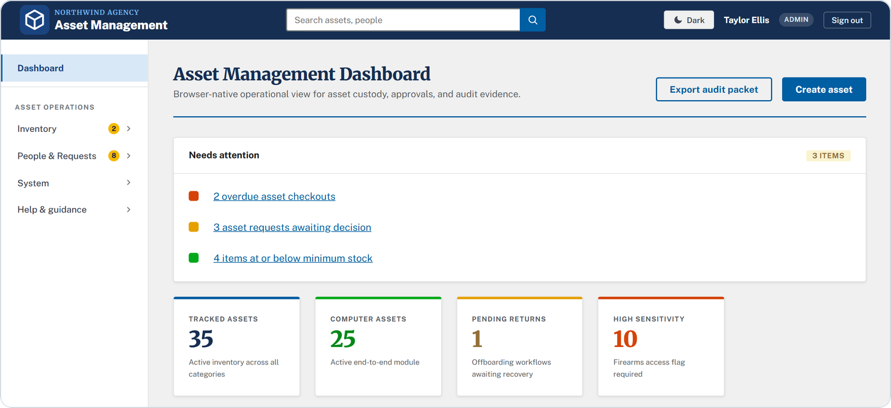</picture></a>

<b>AssetManagement</b> · who holds each piece of equipment, approvals and an audit log · demo data

| &nbsp;&nbsp;&nbsp;&nbsp;&nbsp;&nbsp;&nbsp;&nbsp;&nbsp;&nbsp; | &nbsp;&nbsp;&nbsp;&nbsp;&nbsp;&nbsp;&nbsp;&nbsp;&nbsp;&nbsp;&nbsp;&nbsp;&nbsp;&nbsp;&nbsp;&nbsp;&nbsp;&nbsp;Project&nbsp;&nbsp;&nbsp;&nbsp;&nbsp;&nbsp;&nbsp;&nbsp;&nbsp;&nbsp;&nbsp;&nbsp;&nbsp;&nbsp;&nbsp;&nbsp;&nbsp;&nbsp; | What it does | &nbsp;&nbsp;Built&nbsp;with&nbsp;&nbsp; |
|:-:|---|---|---|
|  | **[AssetManagement](https://github.com/IsaiahAnson/AssetManagement)** | Tracks who holds each piece of equipment, with approvals, custody history and an audit log. Tested in CI against a real database. Demo data only. | <picture><source media="(prefers-color-scheme: dark)" srcset="assets/chip-nextjs-dark.svg"></picture> <picture><source media="(prefers-color-scheme: dark)" srcset="assets/chip-postgresql-dark.svg"></picture> |
| 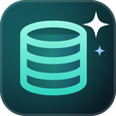 | **[DatabaseBuddy](https://github.com/IsaiahAnson/DatabaseBuddy)** | A scheduled workflow that sorts IT documentation from OneDrive into Notion knowledge bases. | <picture><source media="(prefers-color-scheme: dark)" srcset="assets/chip-pipedream-dark.svg"></picture> <picture><source media="(prefers-color-scheme: dark)" srcset="assets/chip-notion-dark.svg"></picture> |

## <picture><source media="(prefers-color-scheme: dark)" srcset="assets/icon-agents-dark.svg"></picture> AI and developer tools

| &nbsp;&nbsp;&nbsp;&nbsp;&nbsp;&nbsp;&nbsp;&nbsp;&nbsp;&nbsp; | &nbsp;&nbsp;&nbsp;&nbsp;&nbsp;&nbsp;&nbsp;&nbsp;&nbsp;&nbsp;&nbsp;&nbsp;&nbsp;&nbsp;&nbsp;&nbsp;&nbsp;&nbsp;Project&nbsp;&nbsp;&nbsp;&nbsp;&nbsp;&nbsp;&nbsp;&nbsp;&nbsp;&nbsp;&nbsp;&nbsp;&nbsp;&nbsp;&nbsp;&nbsp;&nbsp;&nbsp; | What it does | &nbsp;&nbsp;Built&nbsp;with&nbsp;&nbsp; |
|:-:|---|---|---|
|  | **[AgenticHQ](https://github.com/IsaiahAnson/AgenticHQ)** | A local dashboard for running AI coding agents: skills, routines, usage and a map of the workspace. | <picture><source media="(prefers-color-scheme: dark)" srcset="assets/chip-nodejs-dark.svg"></picture> |
|  | **[BehavioralReconstructionKit](https://github.com/IsaiahAnson/BehavioralReconstructionKit)** | Runs the same steps in an original app and your rebuild of it, in a real browser, and shows where the results differ. | <picture><source media="(prefers-color-scheme: dark)" srcset="assets/chip-playwright-dark.svg"></picture> <picture><source media="(prefers-color-scheme: dark)" srcset="assets/chip-fast-check-dark.svg"></picture> |
| 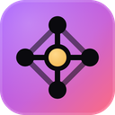 | **[SecondNature](https://github.com/IsaiahAnson/SecondNature)** | A study app with spaced recall, in one HTML file by design. | <picture><source media="(prefers-color-scheme: dark)" srcset="assets/chip-html-dark.svg"></picture> <picture><source media="(prefers-color-scheme: dark)" srcset="assets/chip-javascript-dark.svg"></picture> |

## <picture><source media="(prefers-color-scheme: dark)" srcset="assets/icon-mods-dark.svg"></picture> Game mods

I make game mods as **Mentalize**. Releases are on Thunderstore: [Grain Rot](https://thunderstore.io/c/grain-rot/p/Mentalize/), [R.E.P.O.](https://thunderstore.io/c/repo/p/Mentalize/) and [Risk of Rain 2](https://thunderstore.io/c/riskofrain2/p/Mentalize/).

<picture><source media="(prefers-color-scheme: dark)" srcset="https://raw.githubusercontent.com/IsaiahAnson/IsaiahAnson/stats/downloads-dark.svg"></picture>

| &nbsp;&nbsp;&nbsp;&nbsp;&nbsp;&nbsp;&nbsp;&nbsp;&nbsp;&nbsp; | &nbsp;&nbsp;&nbsp;&nbsp;&nbsp;&nbsp;&nbsp;&nbsp;&nbsp;&nbsp;&nbsp;&nbsp;&nbsp;&nbsp;&nbsp;&nbsp;&nbsp;&nbsp;&nbsp;&nbsp;Mod&nbsp;&nbsp;&nbsp;&nbsp;&nbsp;&nbsp;&nbsp;&nbsp;&nbsp;&nbsp;&nbsp;&nbsp;&nbsp;&nbsp;&nbsp;&nbsp;&nbsp;&nbsp;&nbsp;&nbsp; | What it does | &nbsp;&nbsp;Built&nbsp;with&nbsp;&nbsp; |
|:-:|---|---|---|
| 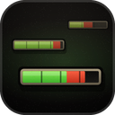 | **[RotVitals](https://github.com/IsaiahAnson/RotVitals)** Grain Rot | Floating health bars above enemies. | <picture><source media="(prefers-color-scheme: dark)" srcset="assets/chip-ue4ss-dark.svg"></picture> <picture><source media="(prefers-color-scheme: dark)" srcset="assets/chip-lua-dark.svg"></picture> |
| 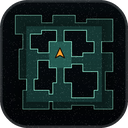 | **[RotRadarMinimap](https://github.com/IsaiahAnson/RotRadarMinimap)** Grain Rot | A live minimap. | <picture><source media="(prefers-color-scheme: dark)" srcset="assets/chip-ue4ss-dark.svg"></picture> <picture><source media="(prefers-color-scheme: dark)" srcset="assets/chip-lua-dark.svg"></picture> |
|  | **[CoinBeams](https://github.com/IsaiahAnson/CoinBeams)** Grain Rot | Loot beams over coins and artifacts. | <picture><source media="(prefers-color-scheme: dark)" srcset="assets/chip-ue4ss-dark.svg"></picture> <picture><source media="(prefers-color-scheme: dark)" srcset="assets/chip-lua-dark.svg"></picture> |
|  | **[RotScaling](https://github.com/IsaiahAnson/RotScaling)** Grain Rot | Enemies gain health, damage, speed and crit as the dungeon level rises. Host-only. | <picture><source media="(prefers-color-scheme: dark)" srcset="assets/chip-ue4ss-dark.svg"></picture> <picture><source media="(prefers-color-scheme: dark)" srcset="assets/chip-lua-dark.svg"></picture> |
|  | **[RotDurability](https://github.com/IsaiahAnson/RotDurability)** Grain Rot | Shows durability as uses remaining instead of a percentage, plus DPS on the damage row. | <picture><source media="(prefers-color-scheme: dark)" srcset="assets/chip-ue4ss-dark.svg"></picture> <picture><source media="(prefers-color-scheme: dark)" srcset="assets/chip-lua-dark.svg"></picture> |
| 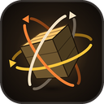 | **[GripandFlip](https://github.com/IsaiahAnson/GripandFlip)** Grain Rot | Three-axis rotation for held objects: hold Alt and move the mouse. | <picture><source media="(prefers-color-scheme: dark)" srcset="assets/chip-ue4ss-dark.svg"></picture> <picture><source media="(prefers-color-scheme: dark)" srcset="assets/chip-lua-dark.svg"></picture> |
| 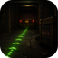 | **[REPOPathfinder](https://github.com/IsaiahAnson/REPOPathfinder)** R.E.P.O. · with [Pez](https://github.com/KaydenceComalander) | An in-world dot trail to the extraction point or the truck. | <picture><source media="(prefers-color-scheme: dark)" srcset="assets/chip-bepinex-dark.svg"></picture> <picture><source media="(prefers-color-scheme: dark)" srcset="assets/chip-csharp-dark.svg"></picture> |
| 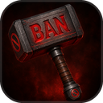 | **[REPOBlacklist](https://github.com/IsaiahAnson/REPOBlacklist)** R.E.P.O. | A host-side blacklist for shop items, valuables and enemies, set from an in-game menu. | <picture><source media="(prefers-color-scheme: dark)" srcset="assets/chip-bepinex-dark.svg"></picture> <picture><source media="(prefers-color-scheme: dark)" srcset="assets/chip-csharp-dark.svg"></picture> |
|  | **[REPOPerformanceKit](https://github.com/IsaiahAnson/REPOPerformanceKit)** R.E.P.O. | Config-file toggles for Unity performance settings: log filtering, garbage collection, mipmap streaming, culling distances and an optional FPS overlay. | <picture><source media="(prefers-color-scheme: dark)" srcset="assets/chip-bepinex-dark.svg"></picture> <picture><source media="(prefers-color-scheme: dark)" srcset="assets/chip-csharp-dark.svg"></picture> |
| 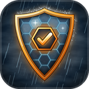 | **[CompatShield](https://github.com/IsaiahAnson/CompatShield)** Risk of Rain 2 | Fixes mods that broke on the October 2026 game update. It patches them in memory as they load, so no mod file is edited. | <picture><source media="(prefers-color-scheme: dark)" srcset="assets/chip-bepinex-dark.svg"></picture> <picture><source media="(prefers-color-scheme: dark)" srcset="assets/chip-csharp-dark.svg"></picture> |
|  | **[FA‑Remaster](https://github.com/IsaiahAnson/FA-Remaster)** Supreme Commander: Forged Alliance | Fixes for a 64-bit engine remake: modded games run without crashes or hangs, late games play smoother, and a lag tool shows what slowed a game down. | <picture><source media="(prefers-color-scheme: dark)" srcset="assets/chip-cpp-dark.svg"></picture> <picture><source media="(prefers-color-scheme: dark)" srcset="assets/chip-lua-dark.svg"></picture> |

  <b>Now:</b> open to Tier 2 desktop support and endpoint roles. 
  Building <a href="https://github.com/IsaiahAnson/LagLens">LagLens</a>, an in-game panel that says why Risk of Rain 2 is lagging.

  <a href="https://isaiahanson.pages.dev/contact"><picture><source media="(prefers-color-scheme: dark)" srcset="assets/btn-contact-dark.svg"></picture></a>
  <a href="https://www.linkedin.com/in/isaiah-anson-b6544514b/"><picture><source media="(prefers-color-scheme: dark)" srcset="assets/btn-linkedin-dark.svg"></picture></a>

